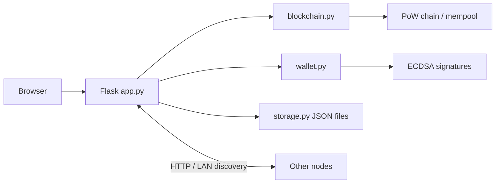

# System architecture and source-code map

The Flask application in `source/app.py` owns per-process global state for a blockchain, wallet, peer set, and JSON storage. Each listening port represents a node. The application exposes HTTP endpoints and a static browser UI; LAN discovery and HTTP synchronization connect multiple instances for educational demonstrations.

| Source file | Concrete responsibility |
|---|---|
| `blockchain.py` | Time-dependent genesis creation, SHA-256 hashes, PoW nonce search, transaction and block checks, mempool, balances, longest-valid-chain selection. |
| `wallet.py` | secp256k1 ECDSA keys/signatures and a 40-hex-character SHA-256-derived address. |
| `app.py` | Flask endpoints, UDP announcements on port 9999, local discovery, health checks, peer registration, HTTP synchronization and broadcasts. |
| `storage.py` | JSON persistence for wallet, chain, peers, mempool and seen transaction IDs in `node_data/node_<port>`. |
| `templates/index.html` | HTML/CSS/JavaScript browser dashboard. |

For transactions, `/transactions/new` signs with the local wallet when no signature is provided, then sends data through `Blockchain.add_transaction()`. Accepted transactions enter the mempool and are broadcast. Mining creates a coinbase transaction, selects up to ten pending transactions, solves PoW with a hash-prefix target, and appends a block.

Peer discovery uses UDP announcements and local HTTP scans. `sync_with_peer()` requests remote `/chain` and `/mempool` resources. `/nodes/resolve` considers remote chains, selecting a longer valid chain. A simple violation counter and blacklist are present, but this is **not** a complete Byzantine fault-tolerant consensus protocol.

Source constants: `difficulty = 4`, `MAX_TX_PER_BLOCK = 10`, `INITIAL_REWARD = 50`, `HALVING_INTERVAL = 100`, `MAX_SUPPLY = 13082005`. They are simulation settings, not measured performance results or Bitcoin mainnet parameters.
